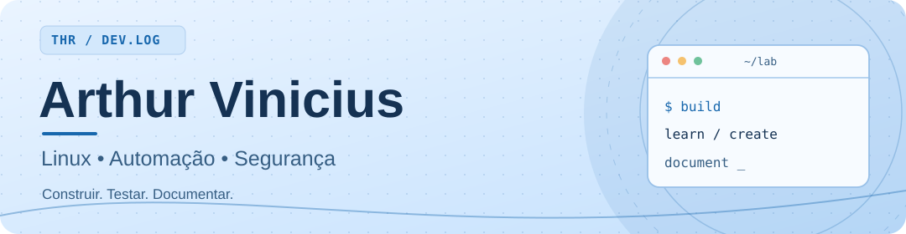

  <picture>
    <source media="(max-width: 600px) and (prefers-color-scheme: dark)" srcset="./assets/header-mobile-dark.svg" />
    <source media="(max-width: 600px)" srcset="./assets/header-mobile-light.svg" />
    <source media="(prefers-color-scheme: dark)" srcset="./assets/header-dark.svg" />
    
  </picture>

## 👋 Sobre mim

Sou estudante e entusiasta de tecnologia, com interesse em **Linux, cibersegurança, redes e automação**.

Uso **Arch Linux com Hyprland** no dia a dia. Gosto de entender o funcionamento dos sistemas, encontrar soluções para problemas reais e documentar o que aprendo. Este perfil reúne projetos práticos, experimentos e registros da minha evolução técnica.

## 🚀 Projetos em destaque

### 🎙️ 01 · [Michael Assistant](https://github.com/Thr-Vinicius/michael-assistant)

**O problema:** facilitar tarefas do desktop sem abrir mão de controle e previsibilidade.

**A solução:** assistente local para Arch Linux com comandos por voz, roteamento seguro das ações permitidas, integração com Hyprland e serviços `systemd` de usuário. A versão atual prioriza estabilidade e **não depende de LLM**.

`Python` · `Bash` · `Hyprland` · `systemd`

### 🎧 02 · [Linux Bluetooth Split Stereo](https://github.com/Thr-Vinicius/linux-bluetooth-split-stereo)

**O problema:** usar dois dispositivos Bluetooth independentes como um par estéreo no Linux.

**A solução:** uma saída virtual que envia o canal esquerdo para um dispositivo e o direito para outro. Um serviço monitora conexões, solicita ressincronização quando necessário e recupera a saída de áudio normal ao desconectar os fones.

`Bash` · `PipeWire` · `WirePlumber` · `BlueZ`

### 🖥️ 03 · [Arch Caelestia Config](https://github.com/Thr-Vinicius/arch-caelestia-config)

**O problema:** manter um ambiente Linux personalizado sem perder organização e capacidade de recuperação.

**A solução:** repositório de dotfiles, listas de pacotes e scripts para backup, atualização e integração visual do **Hyprland + Caelestia**. Inclui documentação e capturas reais do meu desktop.

`Arch Linux` · `Hyprland` · `Quickshell` · `Bash`

### Outros projetos e estudos

- 🔐 **[Cybersecurity Notes](https://github.com/Thr-Vinicius/cybersecurity-notes)** — anotações, exercícios e laboratórios sobre Linux, redes, Python e segurança em ambientes autorizados.
- 🃏 **[Faunadex Arena](https://github.com/Thr-Vinicius/faunadex-frontend)** — protótipo de jogo de cartas desenvolvido em equipe como atividade de front-end.
- 🗃️ **[Assistente MVP](https://github.com/Thr-Vinicius/assistente-mvp)** — projeto encerrado e arquivado, mantido como registro dos meus primeiros experimentos com aplicações web e HomeLab.

## 🛠️ Tecnologias e ferramentas

**No meu ambiente Linux:** `Arch Linux` · `Hyprland` · `Bash` · `systemd` · `PipeWire` · `Git`

**Em projetos e exercícios:** `Python` · `HTML` · `CSS` · `JavaScript` · `FastAPI` · `SQLite`

**Estudando:** fundamentos de cibersegurança e redes, administração de sistemas e inglês técnico.

## 📈 Atividade pública no GitHub

  <picture>
    <source media="(prefers-color-scheme: dark)" srcset="https://github-profile-summary-cards.vercel.app/api/cards/profile-details?username=Thr-Vinicius&amp;theme=github_dark" />
    
  </picture>

  Gráfico gerado por um serviço externo a partir de dados públicos; pode demorar para atualizar.

## 📬 Contato

  <a href="mailto:oliveira.arthur0183@proton.me">✉️ Proton Mail</a>
  &nbsp;·&nbsp;
  <a href="https://www.instagram.com/arthur._vin1/">Instagram</a>
  &nbsp;·&nbsp;
  <a href="https://discord.com/users/1146584107191635978">Discord</a>

---

<em>Aprender. Praticar. Documentar. Evoluir.</em>

